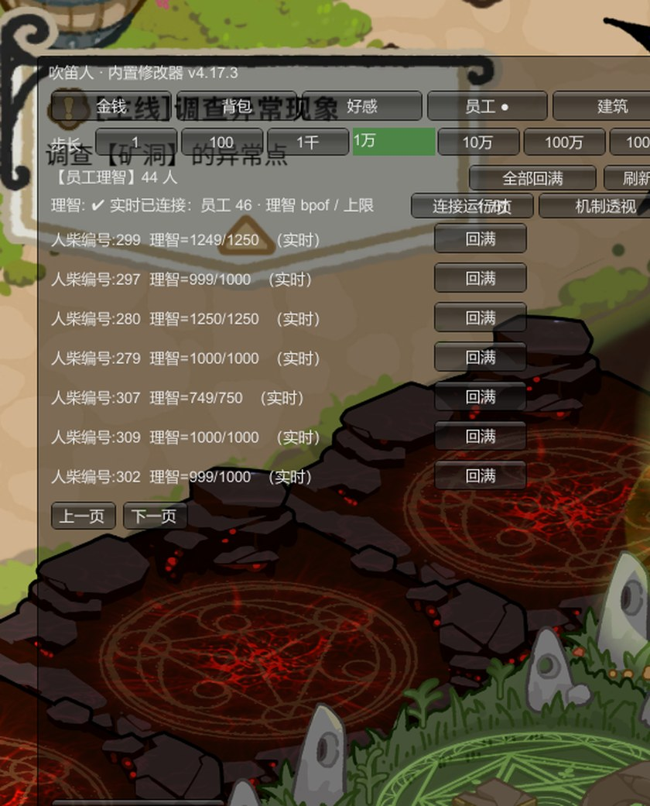

# 吹笛人内置修改器

> 《黎明门前的吹笛人》(The Piper of Dawn) 游戏内置修改器 · BepInEx 6 (IL2CPP) 插件
> 按 **Home** 呼出菜单，修改即时生效 · 免费 · 开源 · 完全离线 · 学习版 / Steam 版通用


**介绍视频（B 站）**：https://www.bilibili.com/video/BV1afJ46jEnp

---

## 为什么用它

- **改的是运行中的游戏进程，不是存档文件**——菜单里点完，游戏内立刻生效，不会被下一次自动存档覆盖
- **理智修改连状态一起还原**：不只把数字填满，「失智」状态也一并解除，不会出现满值但人还在发疯的情况
- 654 种物品全中文名，打字即搜；312 种建筑 / 家具一键获得，图鉴全解锁
- **完全离线**：不联网、不写注册表、不上传任何数据；卸载就是删几个文件

## 功能

| 页面 | 能做什么 |
|---|---|
| **员工（人柴）** | **理智实时回满**：数值 + 状态一起还原（失智一键解除），读档后依然有效；单人 / 全员一键回满 |
| 金钱 | 加 / 减 / 翻倍，步长 1~1000 万 |
| 背包 | 654 种物品：全中文名、打字搜索、分类筛选、数量修改 / 复制 / 还原 |
| 好感 | 32 位可攻略角色好感度、势力声望（等级 / 经验 / 奖励领取） |
| 建筑 | 312 种建筑 / 家具一键获得（游戏内立即可见可摆放）、减少、销毁；图鉴一键全解锁 |



## 下载与安装

1. **下载**：见本仓库 [Releases](https://github.com/yuantianming0721/piper-of-dawn-trainer/releases)（`PiperTrainer_v4.17.7.zip`，约 53 MB，含 .NET 运行时）
2. **安装**：解压后，把解压出来的全部文件（`BepInEx/`、`dotnet/`、`winhttp.dll`、`doorstop_config.ini`）复制到 `ThePiper.exe` 所在目录；提示合并时选「是」
3. **使用**：正常启动游戏，读取存档进入场景后按 **Home** 呼出菜单
4. **卸载**：删除游戏目录下的 `BepInEx/`、`dotnet/`、`winhttp.dll`、`doorstop_config.ini` 即可；游戏本体与存档不受影响

> 建议第一次使用前先备份存档。修改器只改内存与存档数据，不碰游戏本体文件。

## v4.17.7 更新（玩家反馈修复）

- **种子可以种了**：加入背包时同步写入种子存档数据（`SeedSaveData` / 杂交 / 人柴种子），不再是"看得见用不了"
- **金币加减修正**：`加/减` 改为真正的累加；单位修正为 ×1000（游戏 HUD 实测 25552K ↔ raw 25552099317）
- **好感显示修正**：`加/减` 改为累加；按游戏配置阈值显示好感等级（Lv.），不再只显示原始点数
- **配置表链路适配**：物品 / 角色 / 语言 / 好感的配置表全部换到新版链，新装用户也能正常显示名字

<details>
<summary>历史版本</summary>

**v4.17.6**
- 建筑页恢复（313 条中文名）、文本解析入口 eua→evb/evc 修复、图鉴强制段扩到 7299

**v4.17.5（适配 2026-10-21 游戏更新）**
- 移除编译期混淆类型依赖，修复启动 `TypeLoadException`
- 员工理智字段改为运行时自动识别；回满同步游戏帧时间戳

**v4.17.4**
- 人柴理智实时回满：直接写运行时实体，数值 + 状态一起还原
- 修复时间戳补扣、员工页数值不一致

</details>

## 常见问题

**按 Home 没反应？**
确认 `winhttp.dll`、`doorstop_config.ini`、`BepInEx/`、`dotnet/` 都放在 `ThePiper.exe` 同级目录；进游戏读档后稍等几秒再按。仍无反应就看 `BepInEx/LogOutput.log` 末尾的报错。

**杀毒软件报毒 / 拦截？**
`winhttp.dll` 是 BepInEx 的加载器（Doorstop），常被误报。把游戏目录加入白名单即可；本修改器不联网、无下载行为，源码全部在本仓库。

**读档后修改消失了？**
先确认使用的是 v4.17.7 或更新版本。旧版只改存档树，会被游戏的下一次自动存档覆盖。理智修改请在进入场景、员工列表加载完成后再点。

**会不会影响正版存档 / 联机？**
这是单机游戏，修改器不接触服务器。仍建议备份存档，并在使用前关闭云同步。

## 构建（源码）

- **方式一（.NET SDK）**：`cd 源码 && dotnet build -c Debug`。需把 `PiperTrainer.csproj` 里的 `BepInExCore` / `BepInExInterop` 指向目标游戏的 `BepInEx` 目录（首次启动游戏后由 BepInEx 自动生成）
- **方式二（无 SDK，Windows + VS BuildTools）**：运行 `源码\build.cmd`，用 Roslyn csc 直编并自动部署到游戏的 `BepInEx\plugins\`

## 技术说明

- 游戏环境：Unity 2022.3.38f1 + IL2CPP（元数据 v31），加载器 BepInEx 6.0.0-be.788
- 游戏符号被混淆，且**学习版 / Steam 版的混淆名不同**：插件对所有混淆成员走**运行时反射**（零编译期直连），未混淆的存档树 API（`SaveLoadSystem.*`）直接调用，因此两个版本通用
- 理智修改采用「运行时实体直改 + 写前强制重同步 + 时间戳回填」：旧方案改存档树会被自动存档覆盖，等同无效。完整机制与修复记录见 [修改器问题分析_代码依据.md](修改器问题分析_代码依据.md)

## 目录

```
源码/                       插件完整源码（C# / .NET 6 / BepInEx 6 be.788）
  源码/*.cs                 插件本体（Plugin / TrainerUI / PiperBridge / StaffLive 等）
  源码/build.cmd            无 SDK 构建脚本（Roslyn csc 直编）
修改器使用说明.md            功能与使用文档
修改器问题分析_代码依据.md    逆向分析文档（存档结构、理智机制、修复记录）
```

## 声明

仅供学习交流，请于下载后 24 小时内删除并支持正版。
游戏本体 (C) Bone Nail 骨钉工作室。本项目与游戏官方无关。
